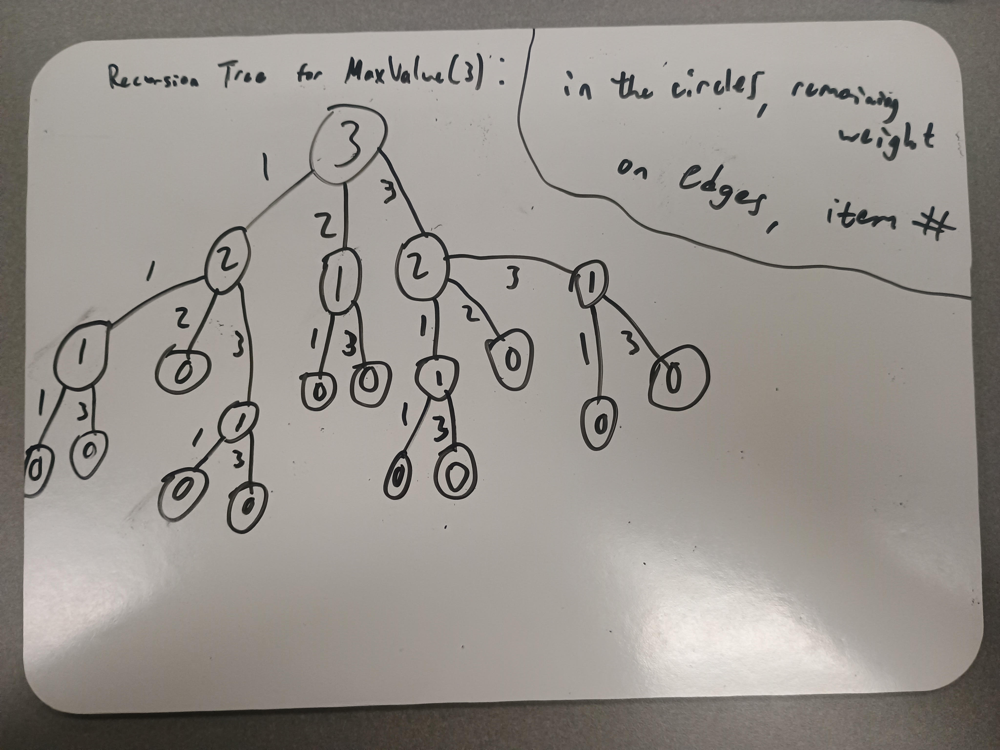

# Lab 07: The Integer-Valued Knapsack Problem

**Name:** Cullen Doyle  

## Introduction
In this lab, you will explore different variations of the Knapsack problem and design a dynamic programming solution for one of them. You may work in small groups or individually, but everyone should write up their own answers to the questions below. 

Suppose we're going hiking. We have items $1, \ldots, n$ that we could pack in multiples with corresponding values $v_1, \ldots, v_n$ and weights $w_1, \ldots, w_n$. For example, we might have a water bottle (weight 1, value 2) and a sandwich (weight 2, value 5). Consider the following three problem variations:

1. Maximize value subject to capacity $W$, where you can pack at most one of each item.
2. Maximize value subject to capacity $W$, where you can pack a positive integer value of each item.
3. Minimize weight subject to minimum value $V$, where you can pack a positive integer value of each item.

---

## Part 1: Dynamic Programming Fundamentals

**Question:** Which of the three problem variations can be solved using the dynamic programming approaches we've studied in lecture? Explain your reasoning.

*Your Answer:* The first, second, and third problem variation can be solved using the dynamic programming approaches we've studied in lecture. For the first and second, there is a target weight capacity that we're reaching for while trying to maximize the values. The difference is that for the first, you can only pack one of each item at most, and for the second, you can pack as many as you want. Dynamic programming can be used for these. For the third, we want to pack the least weight while subject to a minimum value, which is just another target value. Instead, we'll choose the smallest weight combination that directly hits our minimum value. We are pretty much just swapping variables and inequalities.

## Part 2: The Naive Recursive Algorithm

Below is a naive recursive algorithm intended to solve one of the variations listed above.

```text
Function MaxValue(W):
    if W == 0:
        return 0
        
    max_val = 0
    for i from 1 to n:
        if w_i <= W:
            current_val = v_i + MaxValue(W - w_i)
            if current_val > max_val:
                max_val = current_val
                
    return max_val
```

**Question:** Which of the three problem variations (1, 2, or 3) does this algorithm solve? How do you know? Explain your reasoning.

*Your Answer:* 2 because we're looking for a max value, which rules out 3. Also, when we're recurring, we aren't eliminating the chances of the item being used a second time, which rules out 1, making 2 the only option. We're simply maximizing the value with the weight being limited, with items having the capability of being packed twice. 

## Part 3: Recursion Tree

Consider the following simple example:
* **Knapsack Capacity:** $W = 3$
* **Item 1:** Weight $w_1 = 1$, Value $v_1 = 2$
* **Item 2:** Weight $w_2 = 2$, Value $v_2 = 5$
* **Item 3:** Weight $w_3 = 1$, Value $v_3 = 3$

**Question:** Draw the full recursion tree for `MaxValue(3)` using the example above. Label the remaining capacity at each node and indicate which item is chosen along each branch.

*Your Answer (take a picture and upload it):* 


## Part 4: Recurrence Relation

**Question:** Derive a mathematical recurrence relation for $OPT(W)$, the maximum value you can pack into a knapsack of capacity $W$, based on the naive recursive algorithm. Be sure to state your base case(s) and explain how you arrived at your formula.

*Your Answer:* 
$OPT(W)$ = ${0}$               (if w = 0)

or ${max[1<=i<=m ] { v_i+OPT(W - w_i)}}$    (if w > 0)

The base case is when there is no remaining weight (0 weight to be used). For when we have weight to be used, we'll iterate through OPT(W) with W = total weight to consider. Here, we'll consider the max of each of our item combinations in our recursion tree until we have no weight left. We are adding the value from each item considered and subtracting the weight of that item from the total weight when we recurse. Eventually, we'll end up with no weight left to consider, ending the recursion with our maximized value. 


## Part 5: Bottom-Up Dynamic Programming

Instead of using the slow recursive approach, we can build a table bottom-up. 

**Question:** Use your recurrence relation from Part 4 to fill in the following table for the example provided in Part 3 ($w_1=1, v_1=2$ and $w_2=2, v_2=5$). At each step, record the optimal value and the specific item chosen to achieve that value. 

| Capacity ($W$) | Optimal Value ($OPT$) | Item Chosen |
|:---:|:---|:---|
| **0** | **0** | **0** |
| **1** | **3** | **3** |
| **2** | **6** | **3** |
| **3** | **9** | **3** |
| **4** | **12** | **3** |
| **5** | **15** | **3** |
| **6** | **18** | **3** |

*Explain how you calculated the row for $W=6$*
Since item 3 gives more value than item 1 and they weigh the same, we should always pick item 3 over item 1. Also, item 3 when chosen twice for a weight of 2 gives more value than item 2 which weighs 2. So, in every scenerio, we should pack as many item 3s as possible. Thus, we grab 6 items 3s and throw it in the bag, which is worth 18 value (i.e. 3 * 6 = 18).


## Part 6: Traceback

**Question:** Using the "Item Chosen" column from the table you completed in Part 5, trace back to find the exact quantities of each item to pack that maximize the value. What is the final optimal packing configuration for $W=6$ and the maximum value?

*Your Answer:* 
First, we choose item 3, now we have 5 capacity. Then we choose item 3 again, now we have 4 capacity. Then item 3, capacity 3. Then item 3, we have capacity 2. Then item 3, we have capacity 1. Then item 3, we have capacity 0. Then we have capacity 0, so we hit the base case and it's over. The total value occured from these recursions is 18, as we chose item 3 6 times. So, the maximum value is 18 for a weight of 6. 